<!-- Typing SVG animated header -->

> **Systems Architect | Logic Enthusiast | Software Engineer**
> Connecting the dots between rigorous low-level engineering and abstract philosophical inquiry.

---

## ? Current Focus

I build tools that prioritize architectural integrity and clarity. My work spans from language design to high-performance systems and formal logic.

### ??? Featured Projects

<table align="center">
  <tr>
    <td width="33%" align="center" valign="top">
      <a href="https://github.com/ConnerAdamsMaine/TinyOne"><b>TinyOne v2</b></a> 
      <i>Language Design</i> 
      A custom programming language reimagined for its second iteration. Focusing on refined syntax and more robust internal logic.
    </td>
    <td width="33%" align="center" valign="top">
      <a href="https://github.com/ConnerAdamsMaine/RustBukkit"><b>RustBukkit</b></a> 
      <i>Systems Engineering</i> 
      A ground-up rebuild of the Minecraft Server executable in Rust. Prioritizing memory stability and high-throughput performance.
    </td>
    <td width="33%" align="center" valign="top">
      <a href="https://github.com/404connernotfound/CNF-Phi-001.01"><b>CNF-Phi-001.01</b></a> 
      <i>Philosophy</i> 
      A formal exploration into the structures of logic and existence. Applying technical rigor to abstract foundational questions.
    </td>
  </tr>
</table>

---

## ?? Philosophy & Foundations

Software is effectively a formalization of thought. I believe that better systems are born from clear abstractions and a deep understanding of the underlying logic. You can read my latest philosophical paper [here](https://github.com/404connernotfound/CNF-Phi-001.01).

---

## ??? Technical Toolbox

### ?? Languages & Environments

| Category | Tools |
| :--- | :--- |
| **Systems** |     |
| **Scripting** |    |
| **Native** |    |
| **Frontend** |   |

---

## ?? Analytics & Activity

  
  

  

---

  <picture>
    <source media="(prefers-color-scheme: dark)" srcset="https://raw.githubusercontent.com/ConnerAdamsMaine/ConnerAdamsMaine/output/github-contribution-grid-snake-dark.svg" />
    <source media="(prefers-color-scheme: light)" srcset="https://raw.githubusercontent.com/ConnerAdamsMaine/ConnerAdamsMaine/output/github-contribution-grid-snake.svg" />
    
  </picture>

  <i>"Code is the medium, logic is the message."</i>

